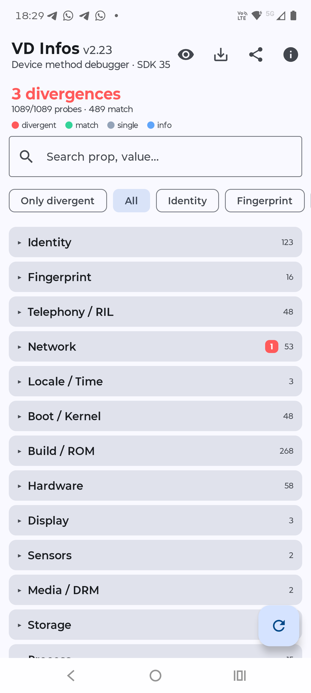

<!--
  VD INFOS - device method debugger: read every device info by every method, then compare.
  Copyright (C) 2026  VD171 - SPDX-License-Identifier: AGPL-3.0-or-later
-->

# VD Infos

<p align="center">
  
</p>

<p align="center">
  <a href="https://github.com/VD171/VD-Infos/releases/latest"></a>
  <a href="LICENSE"></a>
  <a href="https://github.com/VD171/VD-Infos/releases"></a>
  <a href="https://github.com/VD171/VD-Infos/stargazers"></a>
</p>

<p align="center">
  <b>Debugger metode perangkat.</b><br>
  Baca setiap nilai perangkat lewat setiap metode yang mampu membacanya, lalu jajarkan agar Anda bisa membandingkan.
</p>

<p align="center">
  <a href="https://github.com/VD171/VD-Infos/releases">Releases</a> ·
  <a href="CATALOG.md">Catalog</a> ·
  <a href="#contributing">Contributing</a> ·
  <a href="#for-ai-agents-the-full-report-as-json">AI agents</a> ·
  <a href="CHANGELOG.md">Changelog</a> ·
  <a href="https://xdaforums.com/t/VD-Infos.4097379/">XDA thread</a>
</p>

> **Languages:** [English](README.md) · [العربية](README.ar.md) · [Čeština](README.cs.md) · [Deutsch](README.de.md) · [Español](README.es.md) · [فارسی](README.fa.md) · [Français](README.fr.md) · [हिन्दी](README.hi.md) · [Bahasa Indonesia](README.id.md) · [Italiano](README.it.md) · [日本語](README.ja.md) · [한국어](README.ko.md) · [Nederlands](README.nl.md) · [Polski](README.pl.md) · [Português](README.pt.md) · [Русский](README.ru.md) · [Svenska](README.sv.md) · [ไทย](README.th.md) · [Türkçe](README.tr.md) · [Українська](README.uk.md) · [Tiếng Việt](README.vi.md) · [中文](README.zh.md)

<p align="center">
  
  
</p>

---

Android adalah sistem operasi yang sangat kuat dan serbaguna; yang tidak diberitahukan siapa pun adalah bahwa semua detail pribadi dan informasi rahasia Anda tersedia bagi setiap aplikasi yang Anda pasang, dan melindungi diri dari invasi privasi semacam itu adalah kewajiban. VD Infos menunjukkan contoh apa yang bisa diambil dari perangkat Anda, dan melakukannya sebagai *debugger metode*: untuk setiap informasi ia membaca nilainya lewat **setiap metode yang mampu membacanya** - `Build.*`, `SystemProperties`, `getprop`, `__system_property_get` yang native, manager sistem, content provider, berkas, syscall, dan attestation kunci perangkat keras (TEE) - lalu menjajarkannya agar Anda bisa membandingkan. Ketika satu metode berbeda dari yang lain, ada sesuatu di antaranya yang menulis ulang permukaan itu: framework hook, spoofer, shim resolver. **TIDAK ADA INFORMASI YANG DISIMPAN, DIKIRIM, ATAU DITRANSMISIKAN KE BERKAS¹ ATAU SERVER MANA PUN** - semuanya berjalan di perangkat, nilai yang membawa identitas disamarkan sampai Anda mengungkapnya, dan laporan hanya meninggalkan perangkat saat Anda membagikan atau menyimpannya secara eksplisit; jika mau, blokir akses internet dengan firewall atau cukup matikan internet.

> **¹ Pengecualian:** setiap pemindaian menyimpan laporan lengkapnya di penyimpanan privat aplikasi (`files/last_snapshot.json`). Hanya aplikasi itu sendiri atau root yang bisa membacanya, pemindaian berikutnya menimpanya, dan berkas ini tidak pernah keluar dari perangkat. Berkas ini ada agar agen AI bisa membaca hasil lengkap; lihat **Untuk agen AI: laporan lengkap dalam JSON**.

## Yang diperiksa

Setiap item dibaca lewat setiap metode yang mampu membacanya (Java SDK / native / shell), dibandingkan berdampingan:

* **~488 properti sistem** dibaca LIMA cara: `SystemProperties.get`, kedua titik masuk bionic (`__system_property_read_callback` dan `__system_property_get` 92-byte), `getprop` yang dijalankan JVM, dan `getprop` yang dijalankan dari kode native lewat `popen` - perintah shell yang dijalankan `ProcessBuilder` dan perintah sama yang dijalankan tanpa JVM bukan sudut pandang yang sama, karena yang pertama adalah permukaan yang ditulis ulang framework penyembunyi root, dan yang kedua tidak.
* **Identitas perangkat**: model, pabrikan, merek, device, product, board, hardware, fingerprint, bootloader, build id/tags/type - setiap field `Build.*` terhadap semua varian `ro.product.*` (system/vendor/odm), native, dan shell.
* **Pengenal**: serial (banyak getter), Android ID (settings dan provider), GSF ID, advertising ID, IMEI/primary IMEI/MEID/IMSI/ICCID, user serial.
* **Telepon**: permukaan TelephonyManager (operator, SIM, jaringan, roaming...), SubscriptionManager (multi-SIM), cell info.
* **Jaringan**: **MAC** per antarmuka (`NetworkInterface` vs `/sys/class/net` vs shell), Wi-Fi (SSID/BSSID/IP/MAC), Bluetooth, DNS.
* **Kernel / proses / sistem**: `uname`, boot id, uptime, UID/PID, SELinux, zona waktu, locale, environment, layanan/proses berjalan.
* **Perangkat keras / media**: CPU, memori, sensor, layar, kamera, system features, GPU, ID DRM Widevine.
* **Paket / akun / WebView**: daftar dan jumlah paket terpasang, digest tanda tangan per aplikasi, tanda tangan aplikasi ini, introspeksi paket sendiri, enumerasi resolusi intent, akun, jumlah log panggilan, user agent.
* **Kesesuaian sandbox**: permukaan yang seharusnya DITUTUP sandbox (CID/serial eMMC, identitas UFS dan SoC, `/proc/cmdline`, `/proc/1/*`, `/dev/kmsg`, `/system/build.prop`) dan 22 layanan `dumpsys`. Di sini penolakan adalah jawabannya: `EACCES`/`DENIED` adalah bacaan yang sesuai, dan perangkat yang malah menyerahkan isinya tidak sesuai.
* **Pengenal iklan**: GAID dari binder Play Services, plus seluruh keluarga kunci (AAID, OAID/VAID dan `pps_*` Huawei) yang disapu di ketiga settings store.
* **Detektor root / hook / emulator**: artefak `su`/Magisk/KernelSU/APatch/Xposed/LSPosed/Riru, lib yang disuntikkan di `/proc/self/maps`, paket dikenal, properti berbahaya dan emulator, verified boot state.

## Unduh dan dukungan

Setiap rilis menerbitkan dua APK: **SDK_35** menyasar sandbox modern yang ketat dan inilah yang dipakai; **SDK_27** menyasar level API lama, dengan domain SELinux lebih longgar, berguna untuk perbandingan. Keduanya terpasang di Android 8.0 ke atas.

* Release (APK): https://github.com/VD171/VD-Infos/releases
* https://github.com/VD171/VD-Infos
* https://xdaforums.com/t/VD-Infos.4097379/
* https://t.me/RootDetected
* https://t.me/BlankAssistance

## Untuk agen AI: laporan lengkap dalam JSON

Dibuat untuk agen AI dan alat LLM yang bekerja di perangkat melalui shell (asisten pemrograman, skrip analisis). Alih-alih membaca tangkapan layar, agen membaca seluruh hasil dengan satu perintah:

```sh
su -c cat /data/data/ru.vd171.vdinfos/files/last_snapshot.json
```

* **Isinya:** setiap probe beserta putusannya dan nilai semua lensa, dalam JSON yang sama dengan tombol ekspor. Layar hanya menampilkan pembacaan pertama item yang diciutkan; berkas ini memuat semuanya.
* **Kapan diperbarui:** di akhir setiap pemindaian, jadi jalankan pemindaian dulu; berkas selalu berisi yang terbaru.
* **Syarat:** root, karena berkas berada di penyimpanan privat aplikasi.

## Arsitektur

```
core/model      domain immutable: Lens, Category, Verdict, ProbeSpec, ProbeResult
probe/          NativeBridge (JNI) - SystemProps (refleksi) - PropCatalog (data)
                SemanticProbes - IntegrityProbes - ProbeRegistry
engine/         ProbeEngine - fan-out coroutine, mengalirkan hasil sebagai Flow
data/           SnapshotStore (persist + diff) - Exporter (berbagi JSON/teks)
ui/             Jetpack Compose, Material 3, warna dinamis, progres langsung
cpp/            native_probes.cpp - lensa native, tanpa dependensi
```

* **Paralelisme**: 991 probe menyebar di dispatcher default dengan jumlah izin terbatas; hasil mengalir ke UI begitu tiba.
* **Tidak ada di latar belakang**: tanpa layanan dan tanpa pemindaian terjadwal; aplikasi berjalan hanya saat terbuka dan menutup sendiri ketika dibiarkan menganggur.
* **Lapisan native**: satu `.so` kecil, diikat berdasarkan nama lewat `RegisterNatives`, sengaja dibuat mungil karena inilah bagian yang harus sulit ditipu.

## Berkontribusi

Sebagian besar kontribusi tidak butuh Kotlin: daftarnya berupa teks biasa di `VDInfos/app/src/main/assets/data/`. Tambah atau hapus satu baris lalu buka pull request.

* `*_apps.txt` - satu nama paket per baris
* `props.txt` - katalog properti sistem, `KATEGORI<tab>kunci`
* `spoof_keys.txt` - matriks spoof settings, `kunci:TIPE`
* `known_certs.txt` - katalog sertifikat penandatanganan, `SHA-256<tab>pemilik` (hash lengkap, diambil dari APK asli dengan `apksigner verify --print-certs`)
* berkas `.txt` lainnya - juga satu entri per baris (potongan nama modul kernel, nama di `/data/local/tmp`)

Tanda `#` memulai komentar; baris kosong diabaikan. Beberapa berkas memuat beberapa bidang yang dipisah spasi atau tab per baris, atau penanda opsional (`S` dan `@field` di `props.txt`); pertahankan bentuk baris yang sudah ada di berkas. Kontribusi kode juga diterima. Dengan berkontribusi Anda setuju karya Anda dirilis di bawah AGPL-3.0-or-later proyek ini.

## Katalog

Referensi penyembunyian dan deteksi root (panduan, modul, framework, detektor) ada di katalog tersendiri: [CATALOG.md](CATALOG.md).

## Ucapan terima kasih

Terima kasih khusus kepada **[frknkrc44](https://github.com/frknkrc44)**, pengembang **[HMA-OSS](https://github.com/frknkrc44/HMA-OSS)**, atas kesungguhan yang dicurahkan. HMA-OSS adalah tempat beberapa perbaikan yang disarankan aplikasi ini diterapkan - menyembunyikan aplikasi target dan menetapkan preset spoof - dan setiap penyebutannya di dalam aplikasi menautkan kembali ke sumbernya.

Tautan, kanal, dan cara mendukungnya: [HMA-OSS.md](HMA-OSS.md).

## Lihat juga

Proyek saudara dari penulis yang sama:

- **[VDGoogle](https://github.com/VD171/VD-Google)**: layanan Google Anda (RCS, Wallet, attestation Play Integrity), dibaca di perangkat Anda tanpa internet.
- **[VDBackup](https://github.com/VD171/VD-Backup)**: pencadangan dan pemulihan penuh aplikasi dan data sebagai root, dikendalikan sepenuhnya dari WebUI.
- **[COPG-VD](https://github.com/VD171/COPG-VD)**: pengusur (spoofer) perangkat yang mengubah fingerprint baru menjadi profil yang koheren dan konsisten.

Pixel `build.prop`: **[@VictorGabriel7Dev/build.prop](https://github.com/VictorGabriel7Dev/build.prop)** (fork of @T3SL4).

## Contacts

* https://vd171.ru
* https://vd.priv8.ru
* **Telegram:** @VD_Priv8 https://t.me/VD_Priv8
* **Channel:** @Priv8_VD https://t.me/Priv8_VD
* **Discord:** @VD.Priv8 https://discord.com/users/1296831918989639721
* **E-mail:** vd.priv8@pm.me
* **XDA-Developers:** @VD171 https://xdaforums.com/m/vd171.4699873/
* **XDA thread:** https://xdaforums.com/t/VD-Infos.4097379/
* **GitHub:** @VD171 https://github.com/VD171

## Lisensi

**GNU AGPL-3.0-or-later** - lihat [LICENSE](LICENSE). Copyleft, termasuk klausul jaringan: siapa pun yang menjalankan versi yang dimodifikasi (bahkan sebagai layanan) wajib menyediakan sumbernya. Dipilih dengan sengaja untuk alat riset/anti-deteksi, agar fork tetap terbuka.

## Merek dagang

VD Infos adalah alat riset dan diagnostik independen, tidak resmi. Alat ini tidak berafiliasi dengan, didukung oleh, atau disponsori oleh vendor mana pun yang perangkat lunak, layanan, atau mereknya dibaca, dideteksi, atau disebutnya (termasuk Google LLC dan Android Open Source Project). "Android", "Google", "Google Play", "Play Integrity", "Widevine" dan semua nama produk, logo, serta merek dagang lainnya adalah milik pemiliknya masing-masing. VD Infos hanya membaca apa yang sudah ada di perangkat Anda dan tidak mengirim apa pun ke mana pun.

## Tags

`android` `privacy` `security` `root-detection` `hook-detection` `spoof-detection` `anti-detection` `tamper-detection` `device-fingerprint` `magisk` `kernelsu` `lsposed` `play-integrity` `attestation` `tee` `keystore` `scanner` `diagnostics` `reverse-engineering` `kotlin`

<!-- doc-footer -->

---

> _Dokumentasi ini dibuat dengan Claude (Anthropic) dan dikelola oleh VD171. Koreksi dan perbaikan dipersilakan; lihat [Contributing](README.md#contributing)._
