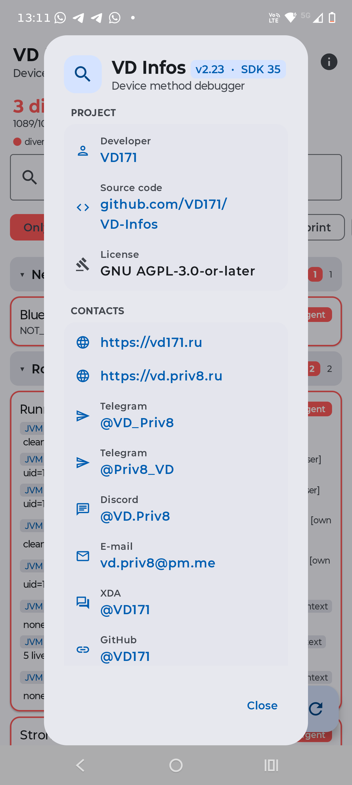

<!--
  VD INFOS: device method debugger: read every device info by every method, then compare.
  Copyright (C) 2026  VD171. SPDX-License-Identifier: AGPL-3.0-or-later
-->

# VD Infos

<p align="center">
  
</p>

<p align="center">
  <a href="https://github.com/VD171/VD-Infos/releases/latest"></a>
  <a href="LICENSE"></a>
  <a href="https://github.com/VD171/VD-Infos/releases"></a>
  <a href="https://github.com/VD171/VD-Infos/stargazers"></a>
</p>

<p align="center">
  <b>Toestel-methode-debugger.</b><br>
  Lees elke waarde van je toestel via elke methode die haar kan lezen, en zet ze op een rij zodat je kunt vergelijken.
</p>

<p align="center">
  <a href="https://github.com/VD171/VD-Infos/releases">Releases</a> ·
  <a href="https://github.com/VD171/VD-Infos/wiki">Wiki</a> ·
  <a href="https://github.com/VD171/VD-Infos/wiki/USER-GUIDE">Gebruikershandleiding</a> ·
  <a href="https://github.com/VD171/VD-Infos/wiki/AI-AGENTS">AI-agents</a> ·
  <a href="https://github.com/VD171/VD-Infos/wiki/EXPORT-FORMAT">Exportformaat</a> ·
  <a href="https://github.com/VD171/VD-Infos/wiki/ARCHITECTURE">Architectuur</a> ·
  <a href="CATALOG.md">Catalogus</a> ·
  <a href="CHANGELOG.md">Changelog</a> ·
  <a href="https://xdaforums.com/t/VD-Infos.4097379/">XDA thread</a>
</p>

> **Languages:** [English](README.md) · [العربية](README.ar.md) · [Čeština](README.cs.md) · [Deutsch](README.de.md) · [Español](README.es.md) · [فارسی](README.fa.md) · [Français](README.fr.md) · [हिन्दी](README.hi.md) · [Bahasa Indonesia](README.id.md) · [Italiano](README.it.md) · [日本語](README.ja.md) · [한국어](README.ko.md) · [Nederlands](README.nl.md) · [Polski](README.pl.md) · [Português](README.pt.md) · [Русский](README.ru.md) · [Svenska](README.sv.md) · [ไทย](README.th.md) · [Türkçe](README.tr.md) · [Українська](README.uk.md) · [Tiếng Việt](README.vi.md) · [中文](README.zh.md)

<p align="center">
  
  
  
</p>

---

Android is een enorm krachtig en veelzijdig besturingssysteem; wat niemand je vertelt, is dat al je persoonlijke gegevens en vertrouwelijke informatie beschikbaar zijn voor elke app die je installeert, en jezelf beschermen tegen deze inbreuken op je privacy is een verplichting. VD Infos toont je een voorbeeld van wat er van je toestel kan worden vastgelegd, en doet dat als een *methode-debugger*: voor elk stukje informatie leest het de waarde via **elke methode die het kan lezen**: framework-API's, native interfaces, shell-commando's, systeemmanagers, content providers, bestanden, syscalls en hardware-sleutel-attestation (TEE), en zet ze naast elkaar zodat je kunt vergelijken. Wanneer één lezing van de andere afwijkt, herschrijft iets ertussenin dat oppervlak: een hooking-framework, een spoofer, een resolver-shim. **ER WORDT GEEN INFORMATIE OPGESLAGEN, VERZONDEN OF DOORGEGEVEN AAN ENIG BESTAND¹ OF SERVER**: alles draait op het toestel, identiteitsdragende waarden zijn gemaskeerd tot je ze onthult, en een rapport verlaat het toestel alleen wanneer je het uitdrukkelijk deelt of opslaat; wil je, blokkeer dan internettoegang met een firewall of zet het gewoon uit.

> **¹ Uitzondering:** elke scan bewaart zijn volledige rapport in de privéopslag van de app (`files/last_snapshot.json`). Alleen de app zelf of root kan het lezen, de volgende scan overschrijft het en het verlaat het apparaat nooit. Het bestaat zodat AI-agents het volledige resultaat kunnen lezen; zie **Voor AI-agents: het volledige rapport als JSON**.

## Wat het inspecteert

Elk item wordt gelezen via elke methode die het kan lezen (Java-SDK / native / shell), naast elkaar vergeleken:

* **~488 systeemeigenschappen** gelezen via meerdere onafhankelijke paden: de Java-API, de native eigenschappen-interface en het `getprop` shell-commando dat op verschillende manieren wordt bereikt, vervolgens naast elkaar gezet en vergeleken. Omdat deze paden niet allemaal door dezelfde laag lopen, verschijnt een waarde die op het ene pad wel maar op het andere niet is herschreven als een afwijking.
* **Toestelidentiteit**: model, fabrikant, merk, device, product, board, hardware, fingerprint, bootloader, build id/tags/type, elk `Build.*`-veld tegen al zijn `ro.product.*`-varianten (system/vendor/odm), native en shell.
* **Identifiers**: serial (veel getters), Android ID (settings en provider), GSF ID, advertising ID, IMEI/primary IMEI/MEID/IMSI/ICCID, user serial.
* **Telefonie**: het TelephonyManager-oppervlak (operator, SIM, netwerk, roaming...), SubscriptionManager (multi-SIM), cell info.
* **Netwerk**: **MAC** per interface (`NetworkInterface` vs `/sys/class/net` vs shell), Wi-Fi (SSID/BSSID/IP/MAC), Bluetooth, DNS.
* **Kernel / proces / systeem**: `uname`, boot id, uptime, UID/PID, SELinux, tijdzone, locale, omgeving, draaiende services/processen.
* **Hardware / media**: CPU, geheugen, sensoren, scherm, camera's, system features, GPU, Widevine-DRM-ID.
* **Pakketten / accounts / WebView**: lijst en aantal geïnstalleerde pakketten, ondertekeningsdigests per app, handtekening van deze app, introspectie van het eigen pakket, intent-resolutie-enumeraties, accounts, aantal oproeplogboek-items, user agent.
* **Sandbox-conformiteit**: low-level identiteits- en kerneloppervlakken, plus een set `dumpsys`-services, die een correct gesandboxte app niet zou mogen kunnen bereiken. Hiervoor controleert de app of de toegang correct wordt geweigerd; een oppervlak dat bereikbaar is terwijl dat niet zou moeten, wordt gemarkeerd voor nadere beschouwing.
* **Advertentie-identifiers**: de GAID via de Play Services-binder, plus de hele sleutelfamilie (AAID, OAID/VAID en Huawei's `pps_*`) doorzocht in de drie settings stores.
* **Root- / hook- / emulatordetectoren**: artefacten en signalen die veelvoorkomende root-managers, hooking-frameworks en emulators achterlaten (Magisk, KernelSU, APatch, Xposed/LSPosed, Riru en dergelijke), plus verified boot state.

## Downloaden en ondersteuning

Elke release publiceert twee APK's: **SDK_35** richt zich op de strikte moderne sandbox en is degene om te gebruiken; **SDK_27** richt zich op een ouder API-niveau, handig ter vergelijking. Beide installeren op Android 8.0 en nieuwer.

* Release (APK): https://github.com/VD171/VD-Infos/releases
* https://github.com/VD171/VD-Infos
* https://xdaforums.com/t/VD-Infos.4097379/
* https://t.me/RootDetected
* https://t.me/BlankAssistance

## Voor AI-agents: het volledige rapport als JSON

Gemaakt voor AI-agents en LLM-tools die via een shell op het apparaat werken (programmeerassistenten, analysescripts). In plaats van screenshots te lezen, leest de agent het hele resultaat met één opdracht:

```sh
su -c cat /data/data/ru.vd171.vdinfos/files/last_snapshot.json
```

* **Inhoud:** elke sonde met haar oordeel en de waarde van alle lenzen, in dezelfde JSON als de exportknop. Het scherm toont bij een ingeklapt item alleen de eerste meting; het bestand bevat ze allemaal.
* **Wanneer het bijwerkt:** aan het einde van elke scan, dus voer eerst een scan uit; het bestand bevat altijd de nieuwste.
* **Vereiste:** root, omdat het bestand in de privéopslag van de app staat.

## Architectuur

```
core/model      onveranderlijk domein: Lens, Category, Verdict, ProbeSpec, ProbeResult
probe/          NativeBridge (JNI), SystemProps (reflectie), PropCatalog (data)
                SemanticProbes, IntegrityProbes, ProbeRegistry
engine/         ProbeEngine: coroutine fan-out, streamt resultaten als Flow
data/           SnapshotStore (opslaan + diff), Exporter (JSON-/tekstdeling)
ui/             Jetpack Compose, Material 3, dynamische kleur, live voortgang
cpp/            native_probes.cpp: de native lens, zonder afhankelijkheden
```

* **Parallellisme**: Probes waaieren uit over de standaard-dispatcher met een begrensd aantal permits; resultaten stromen de UI in zodra ze binnenkomen.
* **Niets op de achtergrond**: geen services en geen geplande scans; de app draait alleen zolang hij open is en sluit zichzelf wanneer hij inactief blijft.
* **Native laag**: één kleine `.so` zonder afhankelijkheden, op naam gebonden via `RegisterNatives`, bewust piepklein en eenvoudig gehouden.

## Bijdragen

De meeste bijdragen hebben geen Kotlin nodig: de lijsten staan als platte tekst in `VDInfos/app/src/main/assets/data/`. Voeg een regel toe of verwijder er een en open een pull request.

* `*_apps.txt`: één pakketnaam per regel
* `props.txt`: de catalogus van systeemeigenschappen, `CATEGORIE<tab>sleutel`
* `spoof_keys.txt`: de settings-spoofmatrix, `sleutel:TYPE`
* `known_certs.txt`: de catalogus van ondertekeningscertificaten, `SHA-256<tab>eigenaar` (volledige hash, uit een echte APK met `apksigner verify --print-certs`)
* overige `.txt`-bestanden: eveneens één item per regel (fragmenten van kernelmodulenamen, namen in `/data/local/tmp`)

Een `#` begint een opmerking; lege regels worden genegeerd. Sommige bestanden bevatten enkele door spatie of tab gescheiden velden per regel, of optionele markeringen (`S` en `@field` in `props.txt`); behoud de vorm van de regels die al in het bestand staan. Codebijdragen zijn ook welkom. Door bij te dragen ga je ermee akkoord dat je werk onder de AGPL-3.0-or-later van dit project valt.

## Catalogus

Referenties voor root-verbergen en -detectie (gidsen, modules, frameworks, detectoren) staan in een aparte catalogus: [CATALOG.md](CATALOG.md).

## Dankbetuigingen

Speciale dank aan **[frknkrc44](https://github.com/frknkrc44)**, ontwikkelaar van **[HMA-OSS](https://github.com/frknkrc44/HMA-OSS)**, voor de zorg die erin is gestoken. HMA-OSS is waar verschillende van de fixes die deze app voorstelt worden toegepast (doel-apps verbergen en spoof-presets instellen), en elke vermelding ervan in de app linkt terug naar de bron.

Zijn links, kanalen en hoe je het steunt: [HMA-OSS.md](HMA-OSS.md).

## Documentatie

- **[Wiki](https://github.com/VD171/VD-Infos/wiki)**: alle documentatie, online te lezen in 22 talen.
- **[Gebruikershandleiding](https://github.com/VD171/VD-Infos/wiki/USER-GUIDE)**: installeren, een scan uitvoeren, het resultaat lezen en een rapport delen.
- **[Voor AI-agents](https://github.com/VD171/VD-Infos/wiki/AI-AGENTS)** en **[Exportformaat](https://github.com/VD171/VD-Infos/wiki/EXPORT-FORMAT)**: het machineleesbare rapport en het schema ervan.
- **[Architectuur](https://github.com/VD171/VD-Infos/wiki/ARCHITECTURE)** en **[Bouwen](https://github.com/VD171/VD-Infos/wiki/BUILDING)**: hoe het werkt en hoe je het bouwt.
- **[Privacy](https://github.com/VD171/VD-Infos/wiki/PRIVACY)**, **[Beveiliging](https://github.com/VD171/VD-Infos/wiki/SECURITY)** en **[Gedragscode](https://github.com/VD171/VD-Infos/wiki/CODE_OF_CONDUCT)**: de privacyverklaring en de governance-documenten.
- **[Catalogus](CATALOG.md)**: referenties voor het verbergen van root en detectie (handleidingen, modules, frameworks en detectoren).
- **[Changelog](CHANGELOG.md)**: wat er in elke release is veranderd.
- **[HMA-OSS](https://github.com/VD171/VD-Infos/wiki/HMA-OSS)**: de module voor het verbergen van apps waarop de fixes van de app voortbouwen (de links, kanalen en hoe je het steunt).
- **[Bijdragen](https://github.com/VD171/VD-Infos/wiki/CONTRIBUTING)**: hoe je detectiedoelen toevoegt (meestal platte-tekstlijsten, geen Kotlin nodig).

<!-- /vd-docs -->

## Zie ook

Zusterprojecten van dezelfde auteur:

- **[VDGoogle](https://github.com/VD171/VD-Google)**: je Google-diensten (RCS, Wallet, Play Integrity-attestations), op je toestel gelezen zonder internet.
- **[VDBackup](https://github.com/VD171/VD-Backup)**: volledige back-up en herstel van apps en gegevens als root, volledig aangestuurd vanuit een WebUI.
- **[COPG-VD](https://github.com/VD171/COPG-VD)**: een toestelspoofer die een verse fingerprint omzet in een coherent, consistent profiel.
- **[VD-dropbear](https://github.com/VD171/VD-dropbear)**: een op zichzelf staande geroote SSH-daemon (Dropbear).

Pixel `build.prop`: **[@VictorGabriel7Dev/build.prop](https://github.com/VictorGabriel7Dev/build.prop)** (fork of @T3SL4).

## Contact

- https://vd171.ru
- https://vd.priv8.ru
- **Telegram:** @VD_Priv8 https://t.me/VD_Priv8
- **Channel:** @Priv8_VD https://t.me/Priv8_VD
- **Discord:** @VD.Priv8 https://discord.com/users/1296831918989639721
- **E-mail:** vd.priv8@pm.me
- **XDA-Developers:** @VD171 https://xdaforums.com/m/vd171.4699873/
- **XDA thread:** https://xdaforums.com/t/VD-Infos.4097379/
- **GitHub:** @VD171 https://github.com/VD171

## Licentie

**GNU AGPL-3.0-or-later**: zie [LICENSE](LICENSE). Copyleft, inclusief de netwerkclausule: iedereen die een gewijzigde versie draait (zelfs als dienst) moet de broncode ervan aanbieden. Bewust gekozen voor een onderzoeks-/anti-detectietool, om forks open te houden.

## Handelsmerken

VD Infos is een onafhankelijk, onofficieel onderzoeks- en diagnosehulpmiddel. Het is niet verbonden met, onderschreven door of gesponsord door een van de leveranciers wier software, diensten of merken het leest, detecteert of noemt (waaronder Google LLC en het Android Open Source Project). "Android", "Google", "Google Play", "Play Integrity", "Widevine" en alle andere productnamen, logo's en handelsmerken zijn eigendom van hun respectieve eigenaren. VD Infos leest alleen wat al op je toestel staat en stuurt nergens iets naartoe.

## Tags

`android` `privacy` `security` `root-detection` `hook-detection` `spoof-detection` `anti-detection` `tamper-detection` `device-fingerprint` `magisk` `kernelsu` `lsposed` `play-integrity` `attestation` `tee` `keystore` `scanner` `diagnostics` `reverse-engineering` `kotlin`
