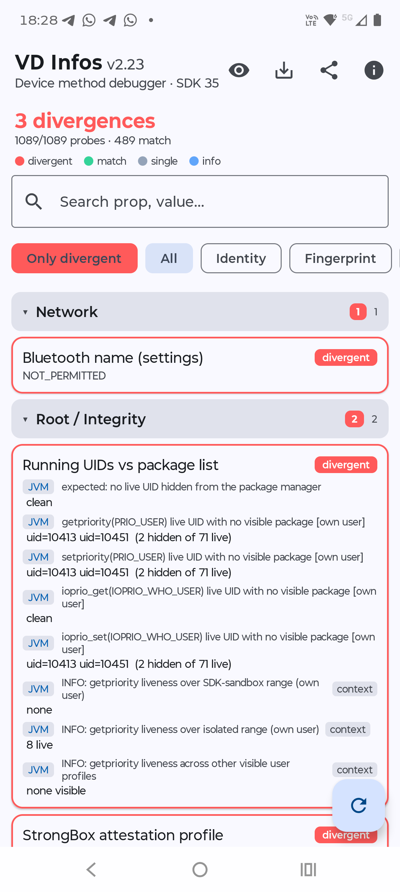

<!--
  VD INFOS: device method debugger: read every device info by every method, then compare.
  Copyright (C) 2026  VD171. SPDX-License-Identifier: AGPL-3.0-or-later
-->

# VD Infos

<p align="center">
  
</p>

<p align="center">
  <a href="https://github.com/VD171/VD-Infos/releases/latest"></a>
  <a href="LICENSE"></a>
  <a href="https://github.com/VD171/VD-Infos/releases"></a>
  <a href="https://github.com/VD171/VD-Infos/stargazers"></a>
</p>

<p align="center">
  <b>Trình gỡ lỗi phương thức thiết bị.</b><br>
  Đọc mọi giá trị thiết bị qua mọi phương thức có thể đọc được nó, rồi xếp chúng cạnh nhau để bạn so sánh.
</p>

<p align="center">
  <a href="https://github.com/VD171/VD-Infos/releases">Releases</a> ·
  <a href="https://github.com/VD171/VD-Infos/wiki">Wiki</a> ·
  <a href="https://github.com/VD171/VD-Infos/wiki/USER-GUIDE">Hướng dẫn sử dụng</a> ·
  <a href="https://github.com/VD171/VD-Infos/wiki/AI-AGENTS">Tác nhân AI</a> ·
  <a href="https://github.com/VD171/VD-Infos/wiki/EXPORT-FORMAT">Định dạng xuất</a> ·
  <a href="https://github.com/VD171/VD-Infos/wiki/ARCHITECTURE">Kiến trúc</a> ·
  <a href="CATALOG.md">Danh mục</a> ·
  <a href="CHANGELOG.md">Changelog</a> ·
  <a href="https://xdaforums.com/t/VD-Infos.4097379/">XDA thread</a>
</p>

> **Languages:** [English](README.md) · [العربية](README.ar.md) · [Čeština](README.cs.md) · [Deutsch](README.de.md) · [Español](README.es.md) · [فارسی](README.fa.md) · [Français](README.fr.md) · [हिन्दी](README.hi.md) · [Bahasa Indonesia](README.id.md) · [Italiano](README.it.md) · [日本語](README.ja.md) · [한국어](README.ko.md) · [Nederlands](README.nl.md) · [Polski](README.pl.md) · [Português](README.pt.md) · [Русский](README.ru.md) · [Svenska](README.sv.md) · [ไทย](README.th.md) · [Türkçe](README.tr.md) · [Українська](README.uk.md) · [Tiếng Việt](README.vi.md) · [中文](README.zh.md)

<p align="center">
  
  
</p>

---

Android là một hệ điều hành cực kỳ mạnh mẽ và linh hoạt; điều không ai nói cho bạn biết là mọi chi tiết cá nhân và thông tin bí mật của bạn đều sẵn có cho mọi ứng dụng bạn cài đặt, và tự bảo vệ trước những sự xâm phạm quyền riêng tư này là một nghĩa vụ. VD Infos cho bạn thấy một ví dụ về những gì có thể bị thu thập từ thiết bị của bạn, và làm điều đó như một *trình gỡ lỗi phương thức*: với mỗi thông tin, nó đọc giá trị qua **mọi phương thức có thể đọc được nó**: API framework, giao diện native, lệnh shell, các manager hệ thống, content provider, tệp, syscall và attestation khóa phần cứng (TEE), rồi xếp cạnh nhau để bạn so sánh. Khi một kết quả đọc khác với các kết quả còn lại, thứ gì đó ở giữa đang viết lại bề mặt đó: một framework hook, một spoofer, một shim resolver. **KHÔNG THÔNG TIN NÀO ĐƯỢC LƯU, GỬI HAY TRUYỀN ĐẾN BẤT KỲ TỆP¹ HAY MÁY CHỦ NÀO**: mọi thứ chạy trên thiết bị, các giá trị mang danh tính bị che cho đến khi bạn hiển thị chúng, và báo cáo chỉ rời khỏi thiết bị khi bạn chia sẻ hoặc lưu một cách rõ ràng; nếu muốn, hãy chặn truy cập internet bằng tường lửa hoặc chỉ cần tắt nó đi.

> **¹ Ngoại lệ:** mỗi lần quét lưu báo cáo đầy đủ trong bộ nhớ riêng của ứng dụng (`files/last_snapshot.json`). Chỉ chính ứng dụng hoặc root đọc được, lần quét sau sẽ ghi đè và tệp không bao giờ rời khỏi thiết bị. Tệp tồn tại để tác tử AI đọc được kết quả đầy đủ; xem **Dành cho tác tử AI: báo cáo đầy đủ dạng JSON**.

## Nó kiểm tra gì

Mỗi mục được đọc qua mọi phương thức có thể đọc được nó (Java SDK / native / shell), so sánh cạnh nhau:

* **~488 thuộc tính hệ thống** được đọc qua nhiều đường độc lập: Java API, giao diện thuộc tính native, và lệnh shell `getprop` tiếp cận theo những cách khác nhau, rồi xếp cạnh nhau và so sánh. Vì các đường này không cùng đi qua một lớp, một giá trị bị viết lại trên đường này mà không trên đường kia sẽ lộ ra dưới dạng sự khác biệt.
* **Danh tính thiết bị**: model, nhà sản xuất, thương hiệu, device, product, board, hardware, fingerprint, bootloader, build id/tags/type, mỗi trường `Build.*` đối chiếu với tất cả biến thể `ro.product.*` (system/vendor/odm), native và shell.
* **Định danh**: serial (nhiều getter), Android ID (settings và provider), GSF ID, advertising ID, IMEI/primary IMEI/MEID/IMSI/ICCID, user serial.
* **Điện thoại**: bề mặt TelephonyManager (nhà mạng, SIM, mạng, roaming...), SubscriptionManager (đa SIM), cell info.
* **Mạng**: **MAC** theo giao diện (`NetworkInterface` vs `/sys/class/net` vs shell), Wi-Fi (SSID/BSSID/IP/MAC), Bluetooth, DNS.
* **Kernel / tiến trình / hệ thống**: `uname`, boot id, uptime, UID/PID, SELinux, múi giờ, locale, môi trường, dịch vụ/tiến trình đang chạy.
* **Phần cứng / đa phương tiện**: CPU, bộ nhớ, cảm biến, màn hình, camera, system features, GPU, ID DRM Widevine.
* **Gói / tài khoản / WebView**: danh sách và số lượng gói đã cài, digest chữ ký theo ứng dụng, chữ ký của ứng dụng này, tự soi gói của chính mình, liệt kê phân giải intent, tài khoản, số mục nhật ký cuộc gọi, user agent.
* **Tuân thủ sandbox**: các bề mặt danh tính cấp thấp và kernel, cùng một tập dịch vụ `dumpsys`, mà một ứng dụng bị cô lập đúng cách lẽ ra không thể chạm tới. Với những bề mặt này, ứng dụng kiểm tra xem truy cập có bị từ chối đúng cách hay không; một bề mặt có thể chạm tới khi lẽ ra không được sẽ bị đánh dấu để xem xét.
* **Định danh quảng cáo**: GAID từ binder của Play Services, cộng với cả họ khóa (AAID, OAID/VAID và `pps_*` của Huawei) được quét qua ba settings store.
* **Trình phát hiện root / hook / giả lập**: các dấu vết và tín hiệu để lại bởi những trình quản lý root, framework hook và trình giả lập phổ biến (Magisk, KernelSU, APatch, Xposed/LSPosed, Riru và tương tự), cùng verified boot state.

## Tải xuống và hỗ trợ

Mỗi bản phát hành công bố hai APK: **SDK_35** nhắm tới sandbox hiện đại nghiêm ngặt và là bản nên dùng; **SDK_27** nhắm tới mức API cũ hơn, hữu ích để so sánh. Cả hai cài được trên Android 8.0 trở lên.

* Release (APK): https://github.com/VD171/VD-Infos/releases
* https://github.com/VD171/VD-Infos
* https://xdaforums.com/t/VD-Infos.4097379/
* https://t.me/RootDetected
* https://t.me/BlankAssistance

## Dành cho tác tử AI: báo cáo đầy đủ dạng JSON

Dành cho các tác tử AI và công cụ LLM làm việc trên thiết bị qua shell (trợ lý lập trình, script phân tích). Thay vì đọc ảnh chụp màn hình, tác tử đọc toàn bộ kết quả bằng một lệnh:

```sh
su -c cat /data/data/ru.vd171.vdinfos/files/last_snapshot.json
```

* **Nội dung:** mọi đầu dò kèm phán quyết và giá trị của mọi lăng kính, cùng định dạng JSON với nút xuất. Màn hình chỉ hiện lần đọc đầu tiên của một mục đang thu gọn; tệp có tất cả.
* **Khi nào cập nhật:** cuối mỗi lần quét, vì vậy hãy quét trước; tệp luôn chứa lần quét mới nhất.
* **Yêu cầu:** root, vì tệp nằm trong bộ nhớ riêng của ứng dụng.

## Kiến trúc

```
core/model      miền bất biến: Lens, Category, Verdict, ProbeSpec, ProbeResult
probe/          NativeBridge (JNI), SystemProps (phản chiếu), PropCatalog (dữ liệu)
                SemanticProbes, IntegrityProbes, ProbeRegistry
engine/         ProbeEngine: fan-out coroutine, truyền kết quả dưới dạng Flow
data/           SnapshotStore (lưu bền + diff), Exporter (chia sẻ JSON/văn bản)
ui/             Jetpack Compose, Material 3, màu động, tiến trình trực tiếp
cpp/            native_probes.cpp: ống kính native, không phụ thuộc
```

* **Song song**: 996 thăm dò tỏa ra trên dispatcher mặc định với số giấy phép giới hạn; kết quả chảy vào UI ngay khi đến.
* **Không có gì ở nền**: không dịch vụ và không quét theo lịch; ứng dụng chỉ chạy khi đang mở và tự đóng khi bị bỏ không.
* **Lớp native**: một `.so` nhỏ, không phụ thuộc, liên kết theo tên qua `RegisterNatives`, được giữ cố ý tí hon và đơn giản.

## Đóng góp

Hầu hết đóng góp không cần Kotlin: các danh sách là văn bản thuần trong `VDInfos/app/src/main/assets/data/`. Thêm hoặc bớt một dòng rồi mở pull request.

* `*_apps.txt`: mỗi dòng một tên gói
* `props.txt`: danh mục thuộc tính hệ thống, `DANH_MỤC<tab>khóa`
* `spoof_keys.txt`: ma trận spoof settings, `khóa:KIỂU`
* `known_certs.txt`: danh mục chứng chỉ ký, `SHA-256<tab>chủ sở hữu` (hash đầy đủ, lấy từ APK thật bằng `apksigner verify --print-certs`)
* các tệp `.txt` khác: cũng một mục mỗi dòng (mảnh tên mô-đun nhân, tên trong `/data/local/tmp`)

Dấu `#` bắt đầu một chú thích; dòng trống bị bỏ qua. Một số tệp chứa vài trường phân tách bằng dấu cách hoặc tab trên mỗi dòng, hoặc các dấu tùy chọn (`S` và `@field` trong `props.txt`); hãy giữ đúng dạng của các dòng đã có trong tệp. Đóng góp mã nguồn cũng được hoan nghênh. Khi đóng góp, bạn đồng ý rằng công việc của mình được phát hành theo AGPL-3.0-or-later của dự án này.

## Danh mục

Các tham chiếu về ẩn và phát hiện root (hướng dẫn, mô-đun, framework, trình phát hiện) nằm trong một danh mục riêng: [CATALOG.md](CATALOG.md).

## Lời cảm ơn

Cảm ơn đặc biệt tới **[frknkrc44](https://github.com/frknkrc44)**, nhà phát triển **[HMA-OSS](https://github.com/frknkrc44/HMA-OSS)**, vì sự tận tâm dành cho nó. HMA-OSS là nơi áp dụng nhiều bản sửa mà ứng dụng này gợi ý (ẩn ứng dụng mục tiêu và đặt preset spoof), và mọi lần nhắc đến nó trong ứng dụng đều liên kết ngược về nguồn.

Các liên kết, kênh và cách ủng hộ: [HMA-OSS.md](HMA-OSS.md).

## Tài liệu

- **[Wiki](https://github.com/VD171/VD-Infos/wiki)**: toàn bộ tài liệu, có thể xem trực tuyến bằng 22 ngôn ngữ.
- **[Hướng dẫn sử dụng](https://github.com/VD171/VD-Infos/wiki/USER-GUIDE)**: cài đặt, chạy quét, đọc kết quả và chia sẻ báo cáo.
- **[Dành cho tác nhân AI](https://github.com/VD171/VD-Infos/wiki/AI-AGENTS)** và **[Định dạng xuất](https://github.com/VD171/VD-Infos/wiki/EXPORT-FORMAT)**: báo cáo máy đọc được và lược đồ của nó.
- **[Kiến trúc](https://github.com/VD171/VD-Infos/wiki/ARCHITECTURE)** và **[Xây dựng](https://github.com/VD171/VD-Infos/wiki/BUILDING)**: cách hoạt động và cách xây dựng.
- **[Quyền riêng tư](https://github.com/VD171/VD-Infos/wiki/PRIVACY)**, **[Bảo mật](https://github.com/VD171/VD-Infos/wiki/SECURITY)** và **[Quy tắc ứng xử](https://github.com/VD171/VD-Infos/wiki/CODE_OF_CONDUCT)**: tuyên bố về quyền riêng tư và các tài liệu quản trị.
- **[Danh mục](CATALOG.md)**: các tài liệu tham khảo về ẩn root và phát hiện (hướng dẫn, mô-đun, framework và trình phát hiện).
- **[Nhật ký thay đổi](CHANGELOG.md)**: những thay đổi trong mỗi bản phát hành.
- **[HMA-OSS](https://github.com/VD171/VD-Infos/wiki/HMA-OSS)**: mô-đun ẩn ứng dụng mà các bản sửa lỗi của ứng dụng dựa trên (các liên kết, kênh và cách ủng hộ nó).
- **[Đóng góp](https://github.com/VD171/VD-Infos/wiki/CONTRIBUTING)**: cách thêm mục tiêu phát hiện (chủ yếu là danh sách văn bản thuần, không cần Kotlin).

<!-- /vd-docs -->

## Xem thêm

Các dự án anh em của cùng tác giả:

- **[VDGoogle](https://github.com/VD171/VD-Google)**: các dịch vụ Google của bạn (RCS, Wallet, attestation Play Integrity), đọc ngay trên thiết bị của bạn mà không cần internet.
- **[VDBackup](https://github.com/VD171/VD-Backup)**: sao lưu và khôi phục toàn bộ ứng dụng và dữ liệu với quyền root, điều khiển hoàn toàn từ một WebUI.
- **[COPG-VD](https://github.com/VD171/COPG-VD)**: một trình giả mạo thiết bị biến một fingerprint mới tinh thành một hồ sơ mạch lạc, nhất quán.
- **[VD-dropbear](https://github.com/VD171/VD-dropbear)**: một SSH daemon độc lập chạy với quyền root (Dropbear).

Pixel `build.prop`: **[@VictorGabriel7Dev/build.prop](https://github.com/VictorGabriel7Dev/build.prop)** (fork of @T3SL4).

## Liên hệ

- https://vd171.ru
- https://vd.priv8.ru
- **Telegram:** @VD_Priv8 https://t.me/VD_Priv8
- **Channel:** @Priv8_VD https://t.me/Priv8_VD
- **Discord:** @VD.Priv8 https://discord.com/users/1296831918989639721
- **E-mail:** vd.priv8@pm.me
- **XDA-Developers:** @VD171 https://xdaforums.com/m/vd171.4699873/
- **XDA thread:** https://xdaforums.com/t/VD-Infos.4097379/
- **GitHub:** @VD171 https://github.com/VD171

## Giấy phép

**GNU AGPL-3.0-or-later**: xem [LICENSE](LICENSE). Copyleft, bao gồm điều khoản mạng: bất kỳ ai chạy một phiên bản đã sửa đổi (kể cả dưới dạng dịch vụ) phải cung cấp mã nguồn của nó. Được chọn có chủ đích cho một công cụ nghiên cứu/chống phát hiện, để giữ cho các fork luôn mở.

## Thương hiệu

VD Infos là một công cụ nghiên cứu và chẩn đoán độc lập, không chính thức. Nó không liên kết, không được chứng thực hay tài trợ bởi bất kỳ nhà cung cấp nào có phần mềm, dịch vụ hoặc nhãn hiệu mà nó đọc, phát hiện hay nêu tên (bao gồm Google LLC và Android Open Source Project). "Android", "Google", "Google Play", "Play Integrity", "Widevine" và mọi tên sản phẩm, logo và nhãn hiệu khác là tài sản của các chủ sở hữu tương ứng. VD Infos chỉ đọc những gì đã có sẵn trên thiết bị của bạn và không gửi bất cứ thứ gì đi đâu cả.

## Tags

`android` `privacy` `security` `root-detection` `hook-detection` `spoof-detection` `anti-detection` `tamper-detection` `device-fingerprint` `magisk` `kernelsu` `lsposed` `play-integrity` `attestation` `tee` `keystore` `scanner` `diagnostics` `reverse-engineering` `kotlin`
